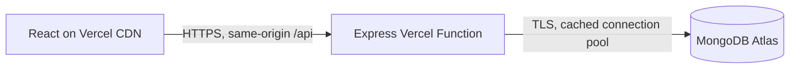
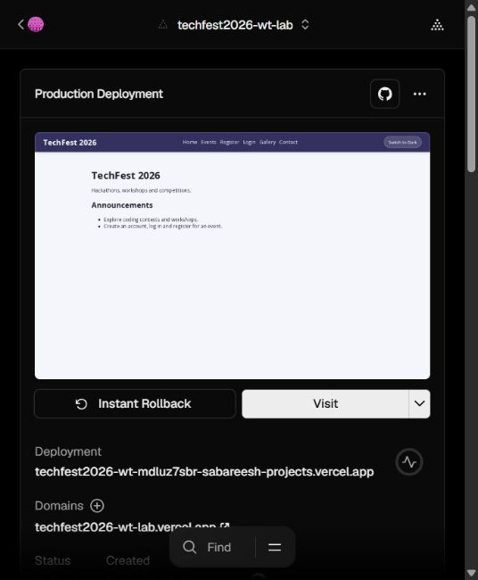
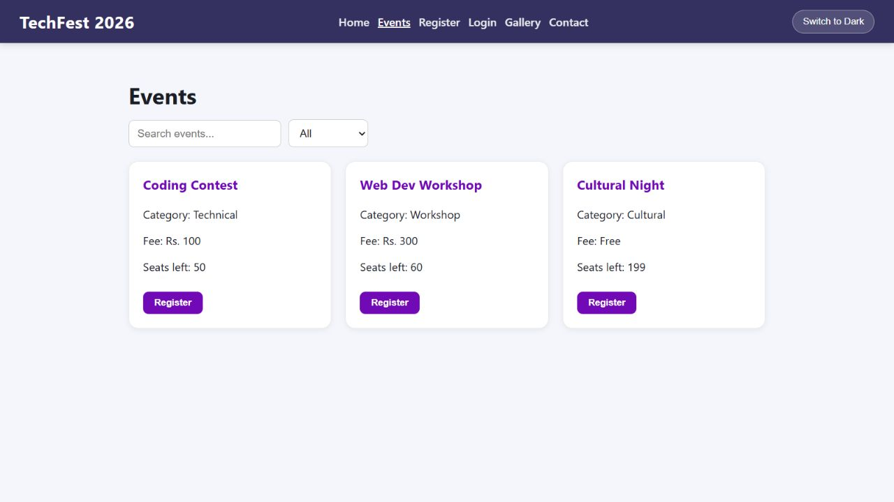
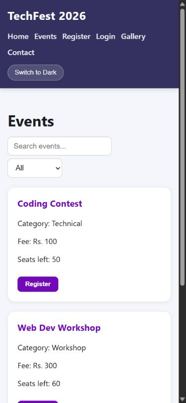

# TechFest 2026 deployment report

Date: 1 November 2026 (IST). Repository: [Sabareesh-pr/wt-lab](https://github.com/Sabareesh-pr/wt-lab). Only this repository was accessed.

## Deployment and architecture

- Frontend: https://techfest2026-wt-lab.vercel.app
- API health: https://techfest2026-wt-lab.vercel.app/api/health
- Database: MongoDB Atlas Cluster0, database `techfest2026`, host `cluster0.8gzui.mongodb.net`. This is a private database endpoint, not a public website. Credentials are omitted.

Vercel builds React and serves it statically. API requests reach `api/index.js`, which connects to Atlas before dispatching to the existing Express routes. Warm invocations reuse one small connection pool. `PORT=5000` is used only locally; the Vercel handler has no port listener. MongoDB credentials and the JWT secret are stored as sensitive Vercel environment variables and excluded from Git. The chosen production origin is explicitly configured for request-origin checks.

The project is deployed successfully. Render was tried earlier but is not the selected deployment platform. No Render URL is presented as a working deployment.

## Security work

| Finding in supplied source | Implemented control |
| --- | --- |
| Three empty model files; API routes never mounted | Added User, Event and Registration schemas and mounted the routes |
| Query inputs could be objects | Scalar input validation, bounded strings, Mongo ID checks and explicitly selected query/update fields |
| JWT stored in localStorage | HttpOnly cookie with SameSite=Strict and Secure in production; JWT excluded from response JSON |
| Any authenticated user could edit events | Server-side admin checks on event mutations; signup cannot assign admin role |
| Missing headers and request controls | Helmet/CSP, HSTS, JSON body limit, API/login rate limits, origin checks and JSON-only mutations |
| Internal errors exposed to clients | Generic responses; private diagnostics contain error classifications rather than credentials |
| Duplicate/concurrent seat allocation | Unique user/event index plus a MongoDB transaction and conditional seat decrement |
| Secrets shipped inside ZIP | Ignored .env before the initial commit; placeholder-only .env.example |

React already escaped user text in the supplied frontend, and there was no feedback form with a demonstrated XSS exploit. No vulnerable route was deliberately published and no exploit before-screenshot was fabricated. SameSite cookies, origin checks and JSON-only mutation requests mitigate CSRF for the same-origin deployment.

## Git and automated delivery

The source was imported on main, implemented on `feature/production-security`, and merged with `--no-ff`. A genuine same-line documentation conflict on `lab/merge-exercise` was resolved in a two-parent merge; see [branching exercise](branching-demo.md) and its Git history.

GitHub Actions installs locked dependencies, runs backend tests and builds React on pushes and pull requests. [Verified green CI run](https://github.com/Sabareesh-pr/wt-lab/actions/runs/41324697278) includes all eleven tests. Vercel's Git integration deploys main automatically; its build command also runs the test suite, preventing publication if tests fail. No deliberately broken remote CI test was pushed.

## Functional and browser verification

Eleven Jest/Supertest tests pass, covering injection rejection before query, security headers, CSRF-origin rejection, authenticated booking, admin authorization, cookie flags, safe errors, public anonymous-session discovery, serverless connection reuse, retry after connection failure and missing configuration.

The [live smoke evidence](evidence/live-smoke.json) records successful HTTPS health, signup, login, HttpOnly/Secure/SameSite cookies, admin rejection, persisted booking, duplicate-booking rejection, exactly one seat decrement, registration retrieval and logout. Synthetic deployment-check accounts and free-event bookings remain as test records. No real payment was made.

Desktop checks in the in-app browser and Brave verified event loading, search, category filtering, gallery navigation, form labels and direct `/events` refresh. Brave was also checked at an observed 375 CSS-pixel mobile viewport: document width and content width matched, with no horizontal overflow. These are emulated viewport checks; Safari, Firefox and physical phones were not tested.

## Performance audit

Chrome Lighthouse 12.8.2 audited the same deployed homepage using mobile settings. Both original HTML/JSON reports are retained:

- [Before HTML](evidence/lighthouse-before.report.html) / [JSON](evidence/lighthouse-before.report.json)
- [After HTML](evidence/lighthouse-after.report.html) / [JSON](evidence/lighthouse-after.report.json)
- [Compact comparison](evidence/performance-summary.json)

| Category | First audit | Final audit |
| --- | ---: | ---: |
| Performance | 98 | 94 |
| Accessibility | 100 | 100 |
| Best practices | 96 | 100 |
| SEO | 82 | 100 |

Four audit findings were fixed: added the meta description; provided a valid robots.txt; returned a quiet null public session for anonymous visitors while keeping private endpoints protected; inlined the small shared stylesheet to remove its blocking network request. All four corresponding final audits pass. The performance score decreased between runs, so no performance-score improvement is claimed. CPU/network variation affects these lab scores.

Final mobile metrics: first contentful paint 1.8 s, largest contentful paint 1.8 s, total blocking time 200 ms, cumulative layout shift 0. Other optimizations include lazy Gallery code, lazy/async dimensioned images with alt text, minification, compressed responses, immutable caching for hashed assets and removal of the artificial home-page delay. Main JS is approximately 190.80 kB (62.58 kB gzip); the separate Gallery chunk is 0.60 kB (0.39 kB gzip). Inlined CSS increased HTML to approximately 3.55 kB (1.46 kB gzip) while removing one blocking request.

## Practical limits

This is a lab deployment, not a full penetration test. Backend development tooling has transitive npm audit advisories; the verified backend production dependency audit and full frontend audit had zero advisories. Function rate counters are per instance, not a distributed quota. Logout clears the browser cookie; a copied JWT can remain valid until its two-hour expiry. The supplied Atlas project had an existing all-IP allowlist; it was not broadened. Narrow that shared project policy before a real production rollout with a known hosting egress strategy.

To reproduce the live API check: `node scripts/smoke-live.cjs https://techfest2026-wt-lab.vercel.app`. It creates a synthetic account and free-event booking. To roll back, use Vercel's previous successful deployment. Keep the MongoDB URI and JWT secret out of the report, screenshots and repository.
