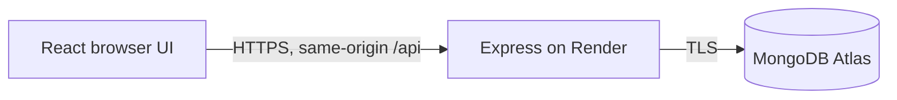
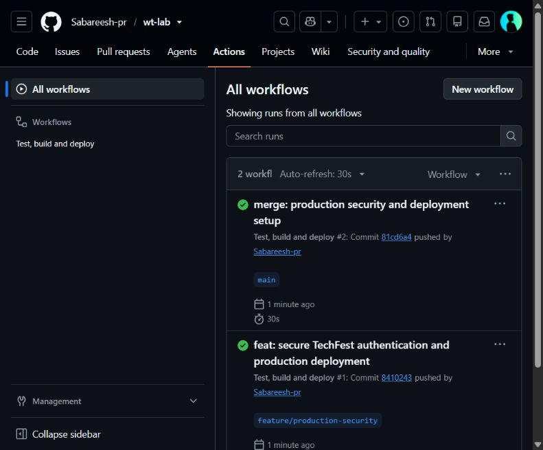
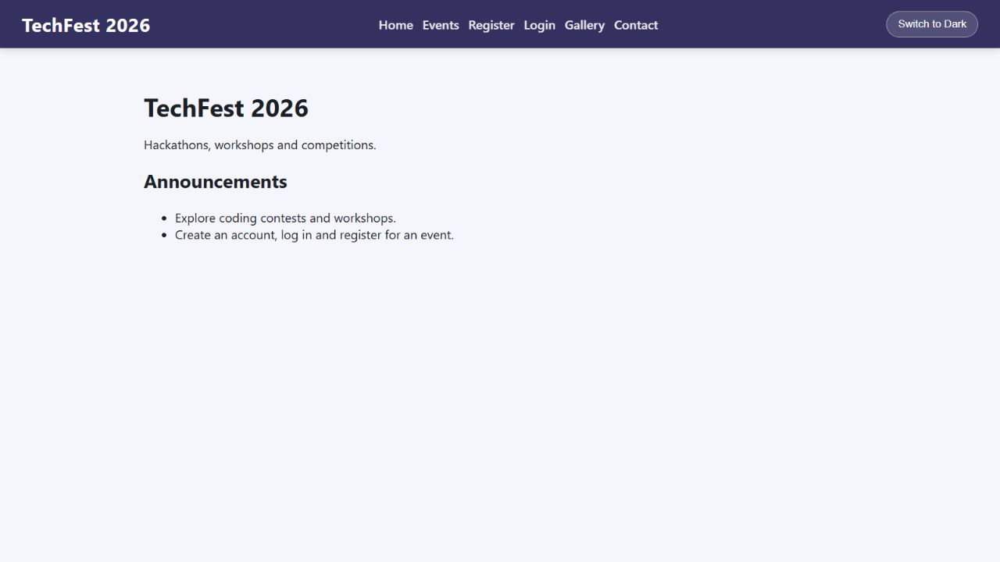
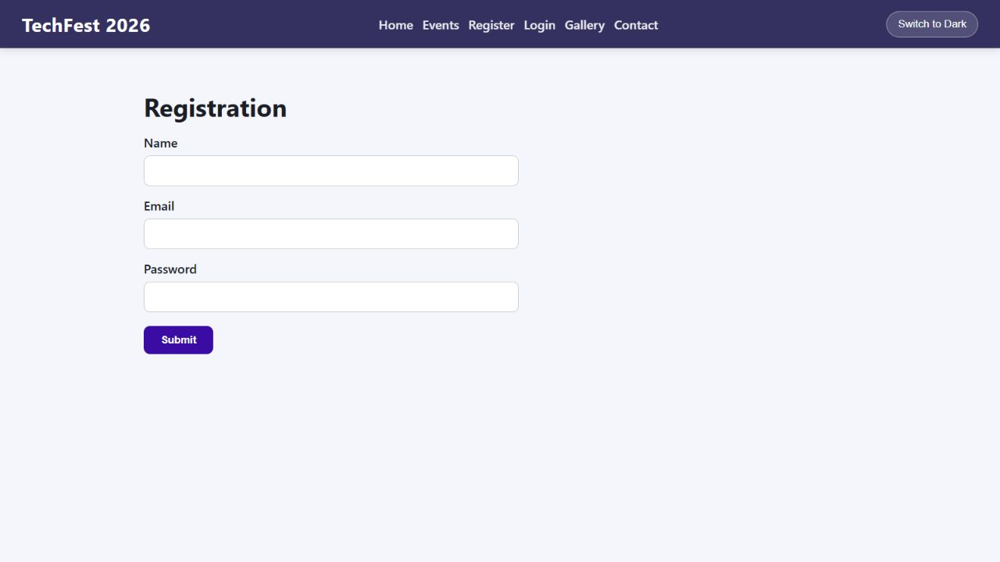

# TechFest 2026 production preparation

Date: 1 November 2026. Repository: https://github.com/Sabareesh-pr/wt-lab.

## Architecture

One service serves the frontend and API, reducing cookie and CORS configuration. The database remains separate. The original three model files were empty and server.js did not mount any routes; both issues were repaired.

## Security findings and fixes

| Original issue | Preventive measure |
| --- | --- |
| Query inputs accepted objects | express-validator enforces scalar email/password, Mongo IDs, bounded strings and numeric fields; query/update fields are explicitly selected |
| Browser token in localStorage | HttpOnly, SameSite=Strict cookie; Secure in production; no JWT in JSON |
| Any logged-in user could edit events | Server-side admin checks on create/update/delete; signup cannot set role |
| Missing request limits and headers | Helmet CSP/HSTS, JSON body limit, API/auth rate limits |
| Unrestricted cross-origin API | Same-origin deployment; mutation Origin/Sec-Fetch-Site checks and JSON-only request bodies |
| Raw errors disclosed internals | Generic error responses and fail-fast environment validation |
| Duplicate or concurrent bookings | Unique user/event index and MongoDB transaction with conditional seat decrement |
| Secrets in supplied archive | Local .env ignored before first commit; example uses placeholders |

React already escaped user text; no feedback form or confirmed XSS exploit existed in the supplied UI. No fabricated before/after exploit screenshot is included. No vulnerable endpoint was intentionally published.

## Validation and performance

- Seven Jest/Supertest security tests pass locally: injection rejection before query, headers, cross-site request rejection, login requirement, admin authorization, secure cookie flags, and safe errors.
- Production frontend build passes. Initial JS: 190.80 kB (62.58 kB gzip); gallery chunk: 0.60 kB (0.39 kB gzip); CSS: 3.05 kB (1.16 kB gzip).
- Four concrete improvements: lazy Gallery route; lazy/async gallery images with explicit dimensions and descriptive alt text; Brotli/gzip-compatible minified Vite output plus Express compression; long-lived immutable caching for hashed assets. Also removed the artificial 800 ms home delay and added form labels/responsive navigation.
- Frontend audit and backend production dependency audit: zero advisories at verification. Backend development tooling still has npm audit advisories (Jest/nodemon transitive dependencies). Do not interpret this as a full penetration test.
- MongoDB connection from the supplied .env failed: it points to localhost, not Atlas.

## Deployment evidence still required

Frontend URL: pending Render deployment.
API URL: pending Render deployment; shares frontend origin at `/api`.
Database: Atlas Cluster0 in the provided project; usable application credentials not yet available locally. Never publish its credential URI.

Live Lighthouse before/after scores, live screenshots, real account persistence/booking, and cross-browser/device results must be appended after deployment. Local test/build results do not establish these. Free Render instances can sleep and cold starts should be measured separately from warm requests.

## Final browser checks

After deployment: verify HTTPS, signup/login/reload/logout, events search/filter, successful booking, repeated booking rejection, SPA deep-link refresh and gallery. Inspect Network for compression/cache headers and cookies for HttpOnly/Secure/SameSite. Run Lighthouse on the same URL with the same device settings twice; retain JSON/HTML and screenshots. Test a narrow mobile viewport and a second browser; record actual browsers and outcomes.

## Recorded evidence

GitHub CI passed on main at commit 81cd6a4: https://github.com/Sabareesh-pr/wt-lab/actions/runs/41317019663. This verifies tests/build; the Render service had not yet been created.

Local in-app browser checks verified navigation, required-name validation, accessible form labels, gallery lazy attributes and descriptive alt text. Viewport override requests did not change the actual 1280 px page viewport, so mobile testing remains unverified. No second-browser or live Lighthouse claim is made.

Git workflow: imported source on main; implemented feature/production-security; merged with --no-ff. A real same-line documentation conflict on lab/merge-exercise was then resolved; see branching-demo.md and its two-parent merge commit.

Render creation form prepared for techfest2026-wt-lab, free plan, health endpoint /api/health, and After CI Checks Pass. Submission is pending Atlas credentials. Native CI-triggered deployment replaces a separate deploy-hook secret.

## Vercel deployment preparation

The requested hosting target is now Vercel. React is built to frontend/dist and served statically; /api/* routes to api/index.js, which reuses the existing Express app and a cached MongoDB pool. The serverless entry point has no port listener. See vercel.json and the Vercel section in README.md.

Local verification: ten tests across security and serverless handling pass; the frontend production build passes. The literal password proposed in chat was rejected by Atlas; a later check also rejected the current ignored .env credential. Vercel project creation reached its email reauthentication gate. No successful Vercel deployment or working live database connection is claimed at this stage.
